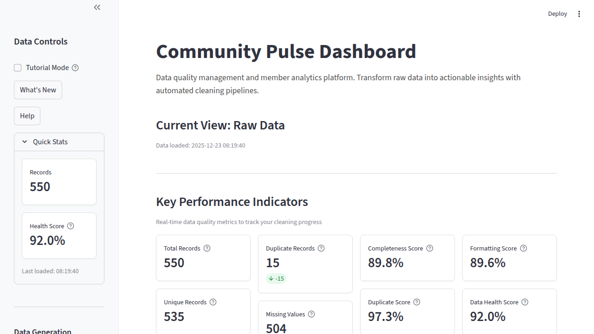
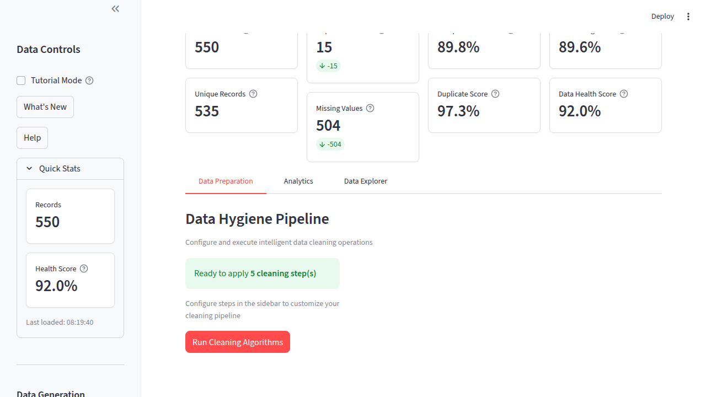
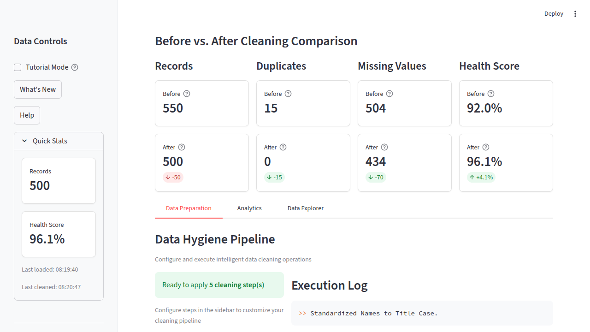
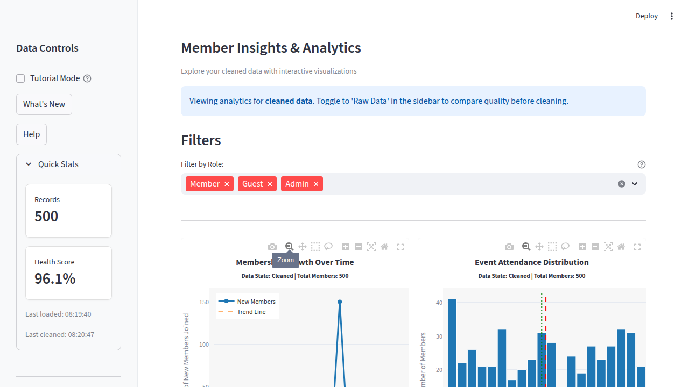

# Portfolio Showcase

**Community Pulse: Data Analytics Dashboard**

A comprehensive demonstration of production-ready software engineering, data analysis, and full-stack development skills.

---

## 🎯 Project Overview

**Live Demo:** [community-pulse.streamlit.app](https://community-pulse.streamlit.app/)  
**GitHub:** [github.com/hilliersmmain/community-pulse](https://github.com/hilliersmmain/community-pulse)  
**Tech Stack:** Python, Streamlit, Pandas, Plotly, Pytest

**What It Does:**  
Community Pulse is a production-ready data analytics dashboard that automatically cleans messy datasets and provides interactive visualizations to explore data quality improvements. It simulates real-world data quality problems found in CRM systems, spreadsheets, and legacy databases, then applies intelligent cleaning algorithms to transform raw data into analysis-ready datasets.

---

## 💡 Problem Statement

**Challenge:** How do you make data quality issues visible and fixable for non-technical users?

Real-world data is messy. Sales teams export CRMs with duplicates. Event organizers collect registrations with inconsistent formats. Data analysts spend 80% of their time cleaning data before analysis can begin.

**Solution:** Build an automated data cleaning pipeline with:
- Visual before/after comparisons to show impact
- Configurable cleaning steps users can control
- Real-time quality metrics that quantify improvements
- Interactive visualizations for data exploration
- Intuitive UI that requires zero technical knowledge

---

## 🚀 Key Achievements

### Production Deployment
✅ **Live Application:** Deployed on Streamlit Cloud, publicly accessible  
✅ **CI/CD Pipeline:** Formatting, linting, type checks, tests, coverage and a Bandit scan with GitHub Actions  
✅ **Tested:** a pytest suite that CI runs on Python 3.11 and 3.12  
✅ **User-Friendly:** a five-step tutorial and contextual help throughout

### Data Quality Impact
| Metric | Before Cleaning | After Cleaning | Improvement |
|--------|----------------|----------------|-------------|
| **Data Health Score** | 93.9% | 97.0% | **+3.1 points** |
| **Duplicate Records** | 45 | 0 | **-100%** |
| **Missing Values** | 369 | 335 | **34 fewer** (only missing attendance is filled) |
| **Formatting Score** | 97.7% | 100.0% | **+2.3 points** |

*Generated data, seed 1, 500 records, messiness "medium", all five cleaning steps; other runs give different numbers.*

### Code Quality Metrics
- **Test Coverage:** CI fails if total coverage drops below 70%
- **Code Quality:** Black formatting, Flake8 linting (complexity limit 10), mypy type checks
- **Documentation:** Complete API docs, development guide, architecture overview
- **Type Safety:** Comprehensive type hints for IDE support

---

## 🎓 Skills Demonstrated

### 1. Python Development

**Object-Oriented Programming:**
```python
class DataCleaner:
    def __init__(self, df: pd.DataFrame):
        """Initialize the DataCleaner with a raw dataframe."""
        self.raw_df = df.copy()
        self.clean_df = df.copy()
        self.log: List[str] = []
        ...

    def clean_all(self, steps=None) -> pd.DataFrame:
        """Runs the full data cleaning pipeline or selected steps."""
        # Modular, reusable, testable
```

**Design Patterns:**
- Pipeline pattern for cleaning operations, each step switchable
- One shared rule per concept: a single duplicate definition and a single email pattern used by both the cleaner and the scoring

**Best Practices:**
- Type hints throughout (`typing` module)
- Comprehensive docstrings
- PEP 8 compliance with Black formatting
- Immutability (copies preserve originals)
- Error handling with informative messages

### 2. Data Engineering

**ETL Pipeline:**
1. **Extract:** Generate or upload raw data
2. **Transform:** Apply 5-stage cleaning pipeline
   - Name standardization
   - Email validation
   - Deduplication (same Email, ignoring case and spaces)
   - Date parsing (unreadable dates left blank, not guessed)
   - Missing attendance filled with 0
3. **Load:** Export raw or cleaned data (CSV/JSON)

**Data Validation:**
- Generator inputs checked (record count, messiness level)
- Uploads checked for the required columns and capped at 5 MB, 50 columns and 50,000 rows
- Format validation (emails, dates, names)
- Integrity checks (duplicates, nulls)

**Quality Metrics:**
```python
# Weighted composite scoring algorithm
overall_score = (
    0.40 * completeness_score +
    0.30 * uniqueness_score +
    0.30 * formatting_score
)
```

### 3. Data Visualization

**Interactive Charts with Plotly:**
- Monthly membership growth line chart with a linear trend line and a mean line
- Distribution histograms with statistical overlays (mean, median)
- Role breakdown pie chart
- PNG export from each chart's toolbar (1000x600 at 2x scale)

**Statistical Analysis:**
- Mean, median, standard deviation and range
- Linear trend fit
- Distribution analysis and binning

### 4. Web Development

**Streamlit Framework:**
- Single-page application with tab navigation (Data Preparation, Analytics, Data Explorer)
- Session state management: each visitor's data stays in their own session
- Responsive CSS styling for professional appearance

**UX Design:**
- Welcome card for first-time users
- Five-step tutorial
- Contextual help tooltips on all metrics
- Loading indicators for long operations
- Success toasts and error messages with actionable feedback

### 5. Software Engineering Practices

**Testing:**
```python
# Comprehensive test coverage (a selection of the test files)
tests/
├── test_data_generator.py    # Synthetic data tests
├── test_cleaner.py           # Pipeline tests
├── test_health_metrics.py    # Scoring tests
├── test_csv_upload.py        # Upload checks
├── test_visualizer.py        # Chart tests
├── test_components.py        # UI components (Streamlit AppTest)
└── test_app.py               # The whole app (Streamlit AppTest)

# Run the suite with a coverage report (sources set in pyproject.toml)
pytest --cov
```

**CI/CD:**
```yaml
# Automated testing on every push/PR to main
- name: Run tests with pytest
  run: pytest tests/ -v --tb=short

# Black, Flake8, mypy, coverage (70% floor) and a Bandit gate run in the same job
```

**Version Control:**
- Version number in `pyproject.toml`
- CHANGELOG maintenance

**Documentation:**
- Comprehensive README with screenshots
- API reference (`docs/API.md`)
- Development guide for contributors
- Architecture overview
- SOP for data cleaning procedures

### 6. DevOps & Deployment

**Infrastructure:**
- Streamlit Cloud deployment (production)
- GitHub Actions CI/CD pipeline
- Dev container for consistent environments
- A Docker recipe in the README for containerized deployment
- Dependabot pull requests for pip and GitHub Actions version updates

---

## 🏗️ Technical Architecture

### System Design

```
┌─────────────────────────────────────────────────────────┐
│                    Streamlit Dashboard                   │
│  (app.py - UI orchestration & session management)       │
└─────────────────────────────────────────────────────────┘
                          │
        ┌─────────────────┼─────────────────┐
        ▼                 ▼                 ▼
┌───────────────┐  ┌──────────────┐  ┌─────────────┐
│ Data Generator│  │ Data Cleaner │  │  Visualizer │
│ (Faker, NumPy)│  │ (Pipeline)   │  │  (Plotly)   │
└───────────────┘  └──────────────┘  └─────────────┘
        │                 │                 │
        └─────────────────┼─────────────────┘
                          ▼
                ┌──────────────────┐
                │ Health Metrics   │
                │ (Quality Scoring)│
                └──────────────────┘
```

### Key Technologies

| Component | Technology | Purpose |
|-----------|-----------|----------|
| **Backend** | Python 3.10+ | Core logic and data processing |
| **Framework** | Streamlit 1.54+ | Web application framework |
| **Data Processing** | Pandas 2.3.3, NumPy 2.2.6 | DataFrame manipulation |
| **Visualization** | Plotly 6.5+ | Interactive charts |
| **Testing** | Pytest 9.0.3+ | Unit tests and Streamlit AppTest runs |
| **Data Generation** | Faker 39+, NumPy | Synthetic data creation |
| **CI/CD** | GitHub Actions | Formatting, linting, type checks, tests, coverage, Bandit |
| **Deployment** | Streamlit Cloud | Production hosting |

### Design Principles

1. **Modularity:** Each utility module has single responsibility
2. **Testability:** The logic in `utils/` is tested apart from the UI
3. **Reusability:** Components can be used independently
4. **Maintainability:** Clear structure, comprehensive documentation
5. **Bounded input:** Generated sets of 100-1000 records; uploads capped at 5 MB, 50 columns and 50,000 rows

---

## 📊 Project Metrics

- **Main classes:** DataGenerator, DataCleaner, DataHealthMetrics
- **Export Options:** CSV, JSON, PNG charts
- **Tutorial Steps:** a five-step guided walkthrough

---

## 🎨 User Interface

### Dashboard Features

**1. KPI Display**
- 8 key metrics, recalculated for the raw or cleaned view
- The Data Health Score's tooltip rates it Excellent, Good or Needs Work
- Tooltips explaining each metric

**2. Before/After Comparison**
- Side-by-side metric comparison
- Deltas for records, duplicates, missing values and health score
- The raw and cleaned charts side by side, or one at a time with a toggle

**3. Interactive Visualizations**
- Monthly membership growth with a trend line
- Distribution histograms with statistical overlays
- Role breakdown pie chart
- Zoom, pan, hover interactions
- PNG export from each chart's toolbar

**4. Configurable Pipeline**
- Toggle individual cleaning steps
- A count of the selected steps before you run them
- An execution log
- A cleaning summary: records removed, health score change and run time

**5. User Guidance**
- Welcome card for new users
- Five-step tutorial
- Contextual help throughout

### Screenshots


*Main dashboard with KPIs and health scores*


*Configurable cleaning pipeline with execution logs*


*Side-by-side comparison showing data quality improvements*


*Time-series visualization with trend analysis*

---

## 💼 Business Value

### For Data Analysts
- **Consistency:** Automated pipeline ensures repeatable results
- **Transparency:** Detailed logs show exactly what changed
- **Validation:** Before/after metrics prove quality improvements

### For Data Engineers
- **Reusable Pipeline:** Modular design for easy integration
- **Extensible:** Add new cleaning steps with minimal code
- **Well-Tested:** a pytest suite that CI runs on every push and pull request to `main`
- **Documented:** an API reference (`docs/API.md`) for integration

### For Business Users
- **No Coding Required:** Point-and-click interface
- **Visual Feedback:** Charts show data distribution and trends
- **Easy Export:** Download cleaned data in multiple formats
- **Quality Metrics:** Understand data health at a glance

---

## 🔄 Future Roadmap

**Planned Enhancements:**

### Phase 2: Database Integration
- [ ] PostgreSQL backend for persistence
- [ ] Multi-user support with authentication
- [ ] Historical data tracking
- [ ] Scheduled cleaning jobs

### Phase 3: Advanced Analytics
- [ ] Machine learning anomaly detection
- [ ] Predictive quality scoring
- [ ] Custom cleaning rule builder
- [ ] Advanced statistical analysis

### Phase 4: Enterprise Features
- [ ] RESTful API for programmatic access
- [ ] Multi-file batch processing
- [ ] Team collaboration tools
- [ ] Email reporting and alerts
- [ ] Role-based access control

### Phase 5: Integrations
- [ ] Salesforce connector
- [ ] Google Sheets integration
- [ ] Excel file support
- [ ] Database connectors (MySQL, MongoDB)
- [ ] Cloud storage integration (S3, GCS)

---

## 🏆 What I Learned

### Technical Skills
- **Advanced Pandas:** Mastered vectorized operations, chaining, and optimization
- **Interactive Visualization:** Created production-quality Plotly charts
- **Streamlit Development:** Built a multi-tab application with per-session state management
- **Test-Driven Development:** Wrote failing tests first, then the fix
- **CI/CD Pipelines:** Automated testing workflows

### Software Engineering
- **Clean Code:** Followed PEP 8, used Black formatting, comprehensive type hints
- **Documentation:** Created user-facing and developer-facing documentation
- **Version Control:** Kept a CHANGELOG
- **Error Handling:** Implemented graceful degradation and user-friendly messages

### Product Development
- **User Experience:** Designed intuitive workflows for non-technical users
- **Feature Prioritization:** Built MVP first, iterated based on feedback
- **Quality Metrics:** Defined and tracked meaningful KPIs
- **Documentation:** Created comprehensive guides for multiple audiences
- **Deployment:** Launched a production application

### Problem Solving
- **Data Quality:** Researched common data quality issues and solutions
- **Algorithm Design:** Developed weighted scoring algorithm for composite metrics
- **Testing Strategy:** Covered edge cases, error conditions, integration scenarios

---

## 📈 Impact & Results

**Demonstrates Capability In:**
1. ✅ Full-stack development (backend + frontend)
2. ✅ Data engineering (ETL pipelines, data validation)
3. ✅ Data visualization (interactive charts, dashboards)
4. ✅ Software testing (unit tests, integration tests, TDD)
5. ✅ DevOps (CI/CD, deployment)
6. ✅ Technical documentation (API docs, guides, READMEs)
7. ✅ UI/UX design (tutorial, tooltips, clear error messages)

**Portfolio Highlights:**
- 🚀 **Production Application:** Live demo accessible to anyone
- 🧪 **Test Coverage:** a pytest suite, with a 70% coverage floor in CI
- 📚 **Documentation:** README, CHANGELOG, contributing and security guides, and the `docs/` folder
- 🎨 **Professional UI:** tooltips, toasts, a guided tutorial
- 🔧 **Modern Tooling:** Type hints, linting, pre-commit hooks
- 📦 **Package Management:** pyproject.toml

---

## 🎯 Hiring Manager Takeaways

**Why This Project Stands Out:**

1. **Production-Ready Code**
   - Not a tutorial project—deployed and actively maintained
   - CI/CD pipeline ensures code quality
   - Comprehensive error handling and validation

2. **Professional Engineering**
   - A pytest suite with meaningful tests and a 70% coverage floor in CI
   - Complete documentation for users and developers
   - Modern Python best practices (type hints, Black, Flake8)

3. **User-Centric Design**
   - Built for non-technical users
   - Intuitive workflow with guidance
   - Visual feedback and validation

4. **Technical Depth**
   - Data engineering pipeline
   - Statistical analysis and visualization
   - Full-stack web development

5. **Business Value**
   - Solves real-world problem (data quality)
   - Quantifiable impact (metrics, before/after)
   - Scalable architecture for future growth

**This project proves I can:**
- ✅ Build production applications from scratch
- ✅ Write clean, tested, maintainable code
- ✅ Design user-friendly interfaces
- ✅ Deploy and maintain live applications
- ✅ Document code for multiple audiences
- ✅ Work independently on full-stack projects

---

## 📞 Connect

**Samuel M. Hillier**  
GitHub: [@hilliersmmain](https://github.com/hilliersmmain)

**Project Links:**
- Live Demo: [community-pulse.streamlit.app](https://community-pulse.streamlit.app/)
- Source Code: [github.com/hilliersmmain/community-pulse](https://github.com/hilliersmmain/community-pulse)
- Documentation: [API Docs](./docs/API.md) | [Development Guide](./docs/DEVELOPMENT.md)

---

*Built with ❤️ using Python, Streamlit, Pandas, and Plotly*
