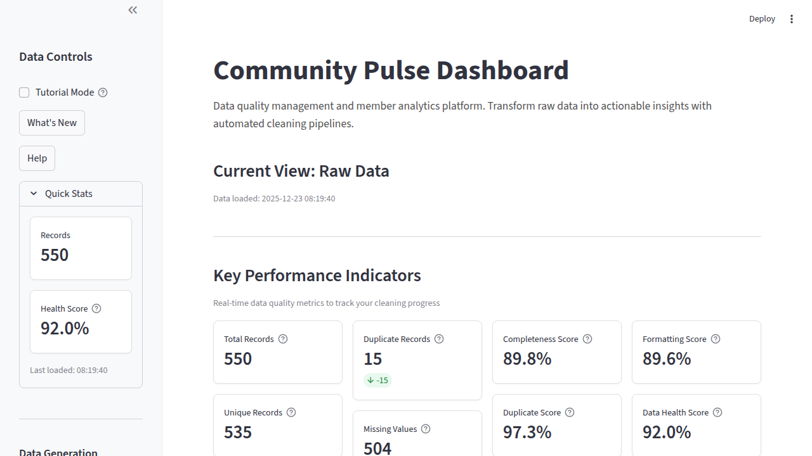
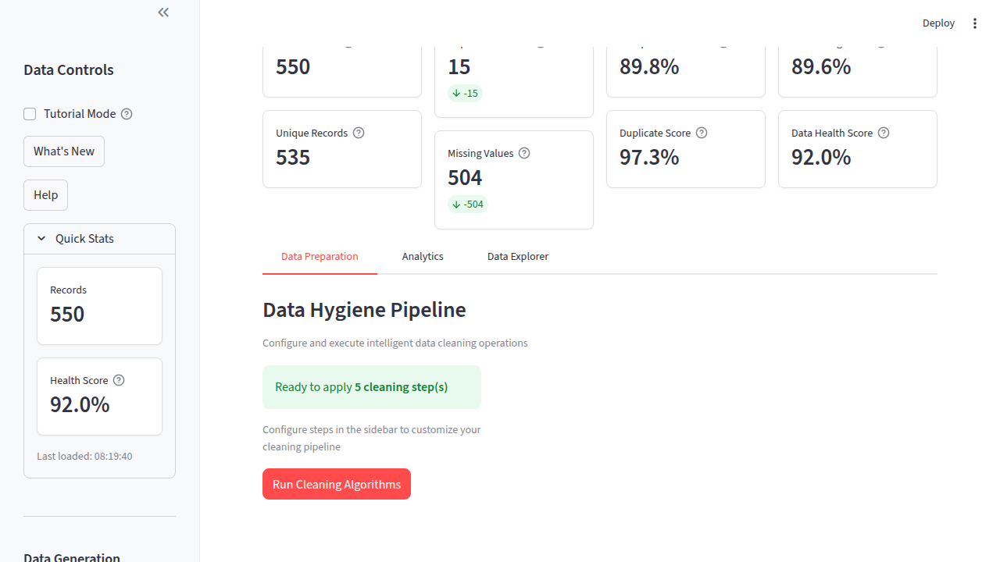
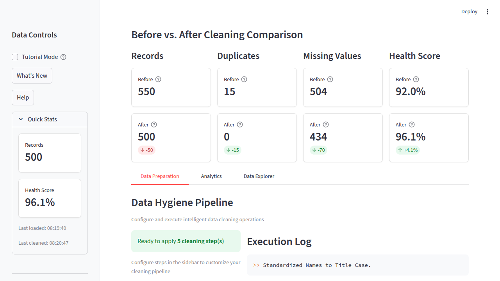
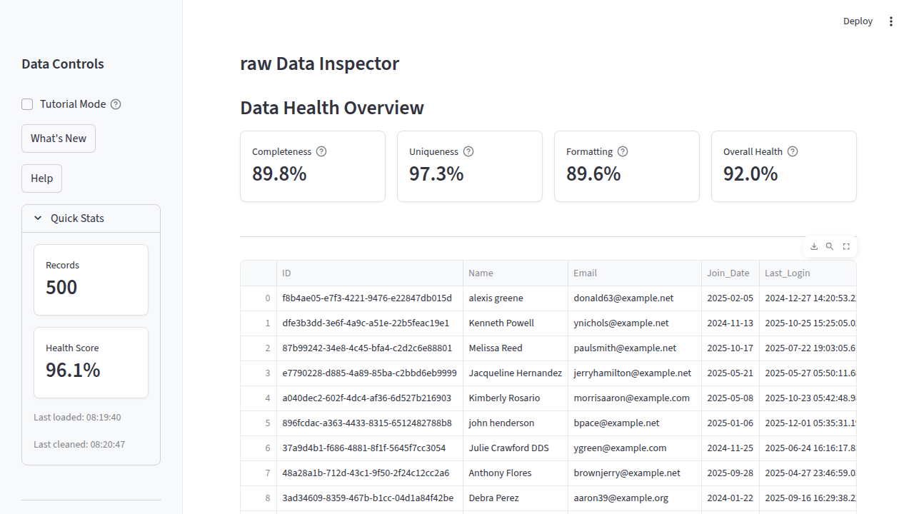

# Community Pulse:  Data Analytics Dashboard

[](https://www.python.org/)
[](https://streamlit.io)
[](https://plotly.com/)
[](https://github.com/hilliersmmain/community-pulse/actions/workflows/ci.yml)
[](./LICENSE)
[](https://community-pulse.streamlit.app/)

A production-grade data analytics platform that transforms raw, unstructured community data into actionable business intelligence.  By automating the entire data engineering lifecycle. From ingestion and cleaning to validation and visualization—it delivers real-time insights into community engagement, growth trends, and member behavior patterns.


---

## [Try the Live Demo →](https://community-pulse.streamlit.app/)
*No installation required — explore the full dashboard instantly*

---

## Dashboard Preview

| Dashboard Overview | Data Cleaning Pipeline |
|:--:|:--:|
|  |  |

| Before/After Comparison | Data Explorer |
|:--:|:--:|
|  |  |

---

## Key Features

**1. Automated Data Engineering Pipeline**

- Two data sources: generate 100-1000 synthetic records at a low, medium or high messiness level, or upload a CSV with the columns `Name`, `Email`, `Role`, `Join_Date` and `Event_Attendance`
- Upload checks: files are capped at 5 MB, 50 columns and 50,000 rows, and a missing required column is named in the error
- Five cleaning steps, each switchable in the sidebar: Standardize Names, Fix Email Formats, Remove Duplicates (same Email, ignoring case and spaces), Clean Dates (every `Join_Date` format read into one date type; unreadable dates are left blank, not guessed) and Handle Missing Values (missing attendance becomes 0)
- An execution log in the Data Preparation tab records what each step did

**2. Interactive Analytics Dashboard**

- Eight KPI tiles: Total Records, Unique Records, Duplicate Records, Missing Values, Completeness Score, Duplicate Score, Formatting Score and Data Health Score
- Plotly charts of the cleaned data in the Analytics tab: membership growth by month with a linear trend line and a mean line, an attendance histogram with mean and median lines, and a role breakdown pie chart
- A Role filter for the Analytics charts, and a PNG export from each chart's toolbar
- A Data Explorer tab showing the raw or cleaned table

**3. Comprehensive Data Quality Monitoring**

- Automated Health Scoring: a composite Data Health Score from completeness (40%), uniqueness (30%) and formatting (30%)
- Before/After Comparison: records, duplicates, missing values and health score before and after cleaning, plus the raw and cleaned charts side by side
- CSV and JSON export of the raw or cleaned data, and a five-step tutorial for first-time users

---

## Impact & Results

| Metric | Before | After | Improvement |
|--------|--------|-------|-------------|
| Records Processed | 550 raw | 499 clean | 51 rows removed |
| Data Health Score | 93.9% | 97.0% | +3.1 points |
| Missing Values | 369 | 335 | 34 fewer (only missing attendance is filled) |
| Duplicate Records | 45 | 0 | Eliminated |

Measured on generated data with seed 1, 500 records and messiness "medium" (the generator adds duplicate rows on top of the 500), all five cleaning steps on; other runs give different numbers.

---

## Quick Start

**Prerequisites:** Python 3.10+

```bash
# Clone and install
git clone https://github.com/hilliersmmain/community-pulse.git
cd community-pulse
python -m venv venv
source venv/bin/activate  # Windows: venv\Scripts\activate
pip install -r requirements.txt

# Launch the dashboard
streamlit run app.py
```

Open browser to `http://localhost:8501`

---

## Usage Workflow

1. Generate Data — Create synthetic community data at a low, medium or high messiness level (100-1000 records)
1b. **Or Upload CSV** — Upload your own data file with `Name`, `Email`, `Role`, `Join_Date`, and `Event_Attendance` columns (up to 5 MB, 50 columns and 50,000 rows)
2. Configure Cleaning — Switch the five cleaning steps on or off in the sidebar, or keep the defaults (all on)
3. Execute Pipeline — Click "Run Cleaning Algorithms" in the Data Preparation tab and read the execution log
4. Analyze Results — Compare the KPI tiles before and after cleaning, filter the Analytics charts by Role, and browse the table in the Data Explorer tab
5. Export Insights — Download the raw or cleaned data (CSV/JSON) from the sidebar, or a chart (PNG) from its toolbar

---

## Technology Stack

| Component | Technology | Purpose |
|-----------|------------|---------|
| Frontend | Streamlit 1.54+ | Interactive web UI with reactive components |
| Data Processing | Pandas 2.3.3, NumPy 2.2.6 | High-performance DataFrame operations |
| Visualization | Plotly 6.5+ | Interactive, publication-quality charts |
| Testing | pytest 9.0.3+ | Unit tests, plus Streamlit AppTest runs of the app and its UI components |
| Data Generation | Faker 39+ | Realistic synthetic data with controlled quality issues |
| CI/CD | GitHub Actions | Formatting, linting, type checks, tests, coverage and a Bandit scan on every push and pull request to `main` |

---

## Project Architecture

```
community-pulse/
├── app.py                    # Thin orchestrator
├── verify_setup.py           # Environment self-check
├── components/               # UI component modules
│   ├── sidebar.py            # Sidebar controls and data source selection
│   ├── kpi_display.py        # KPI metrics row
│   ├── comparison.py         # Before/after comparison section
│   ├── tab_preparation.py    # Data Preparation tab
│   ├── tab_analytics.py      # Analytics tab with charts
│   └── tab_explorer.py       # Data Explorer tab
├── utils/                    # Core processing modules
│   ├── constants.py          # Configuration constants
│   ├── data_generator.py     # Synthetic data generation with configurable noise
│   ├── cleaner.py            # Multi-step cleaning pipeline with logging
│   ├── visualizer.py         # Plotly chart components and themes
│   ├── health_metrics.py     # Quality scoring algorithms
│   ├── duplicates.py         # The one duplicate rule (Email, case and spaces ignored)
│   ├── date_parsing.py       # Reads date columns that mix several formats
│   ├── upload_validation.py  # CSV upload checks (required columns, column and row caps)
│   ├── session_keys.py       # Shared session-state keys
│   └── ui_helpers.py         # Reusable UI components
├── community_pulse/          # demo_charts.py: writes the charts as PNG files
├── scripts/                  # verify_loop.py: the verification loop below
├── tests/                    # The pytest suite
├── docs/                     # Technical documentation
│   ├── API.md                # Module API reference
│   ├── ARCHITECTURAL_OVERVIEW.md
│   └── screenshots/          # Dashboard screenshots
└── .github/workflows/        # CI/CD automation
```

---

## Testing & Quality

```bash
pytest                    # Run the suite
pytest --cov              # Run it with a coverage report
python verify_setup.py    # Verify installation
```

**Quality Metrics:**
- CI runs the suite on Python 3.11 and 3.12; the badge above shows the latest result
- CI fails if total coverage drops below 70%
- Type hints throughout with mypy enforcement
- Comprehensive docstrings

---

## Engineering Verification Workflow

Use the verification loop before every commit to reduce regressions:

```bash
python scripts/verify_loop.py --localhost-check
```

The loop validates formatting, linting, typing, tests, coverage, and localhost app health.

---

## Deployment

**Streamlit Cloud (Recommended):**
1. Push to GitHub
2. Connect at [share.streamlit.io](https://share.streamlit.io)
3. Deploy with one click

**Live Production Instance:** [community-pulse.streamlit.app](https://community-pulse.streamlit.app/)

**Docker:**
```dockerfile
FROM python:3.12-slim
WORKDIR /app
COPY requirements.txt .
RUN pip install -r requirements.txt
COPY . . 
EXPOSE 8501
CMD ["streamlit", "run", "app.py"]
```

---

## Skills Demonstrated

**Data Engineering & Analytics**
- End-to-end ETL pipeline design and implementation
- Data quality assessment and automated remediation
- Statistical analysis and KPI definition
- Interactive data processing and visualization

**Software Engineering**
- Modular, maintainable Python architecture
- Comprehensive test coverage (a pytest suite covering the utils and the UI components)
- CI/CD pipeline with GitHub Actions
- Production deployment on Streamlit Cloud

**Technical Communication**
- Clear documentation and code commenting
- Interactive visualizations for non-technical stakeholders
- API design and developer experience optimization

---

## About the Developer

Sam Hillier — Sophomore at UNC Charlotte bridging data science and artificial intelligence.

Program: B.S. Data Science → B.S in Artificial Intelligence (Fall 2026)
Minors: Cognitive Science, AI
Spring 2026 Coursework: Human-Centered Computing (ITIS 3130), Computer Science II (ITSC 1213), Mathematics for Computer Science (MATH 2112)
Background: Started in Cellular/Molecular Biology at Appalachian State University (2024-2025), where AI's potential in neuroscience, sparked my transition to Data Science/Artificial Intelligence

Interested in AI applications in neuroscience, human-computer interaction, and building & researching the infrastructure and fundamentals that powers intelligent systems from the ground up.


---

## License

MIT License 
